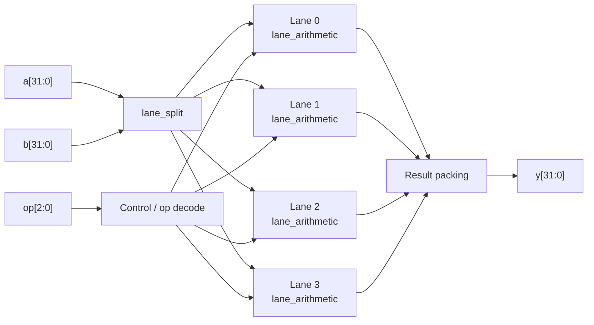

<div align="center">

# ⚡ SIMD Core X

### High-Throughput Vector Processor for DSP and ML

*A small SIMD vector unit that accelerates FIR filtering and dot-product kernels, written in Verilog RTL.*


</div>

---

## 📖 Table of Contents

- [Overview](#-overview)
- [Features](#-features)
- [Architecture](#-architecture)
- [Interface](#-interface)
- [Repository Structure](#-repository-structure)
- [Getting Started](#-getting-started)
- [Simulation Results](#-simulation-results)
- [Why SIMD for FIR and Dot Product?](#-why-simd-for-fir-and-dot-product)
- [Applications](#-applications)
- [Future Work](#-future-work)
- [Tech Stack](#-tech-stack)
- [Author](#-author)

---

## 🔍 Overview

DSP and ML workloads repeat the same arithmetic on large streams of data. Processing one element at a time wastes that regularity.

**SIMD Core X** applies **one instruction to multiple data lanes in a single clock cycle**. A 32-bit operand is split into lanes, every lane executes the selected operation in parallel, and the results are packed back into a 32-bit output. This raises throughput for kernels such as **FIR filtering** and **dot-product** operations.

> **Problem statement:** Create a small SIMD vector unit that accelerates common DSP and ML kernels such as FIR filtering and dot-product operations.
> **Technologies:** Computer architecture · Data paths and control · RTL design

---

## ✨ Features

- 🧩 **Lane-based SIMD data path**: one instruction, multiple data elements
- 🎛️ **3-bit opcode** operation select, broadcast to all lanes
- 🔁 **Modular RTL**: lane split, lane arithmetic and top-level are separate modules
- ✅ **Self-checking testbench** with automatic pass/fail counters
- 🛠️ **Synthesizable** and verified in Xilinx Vivado 2023.2

---

## 🏗️ Architecture



| Module | File | Role |
|---|---|---|
| `lane_split` | `lane_split.v` | Splits packed 32-bit operands into independent lanes |
| `lane_arithmetic` | `lane_arithmetic.v` | Per-lane arithmetic/logic selected by `op` |
| `simd_corex` | `simd_corex.v` | Top level: instantiates lanes, distributes control, packs result |
| `tb_simd_corex` | `tb_simd_corex.v` | Self-checking testbench (simulation only) |

---

## 🔌 Interface

| Signal | Direction | Width | Description |
|---|---|---|---|
| `clk` | Input | 1 | System clock |
| `rst` | Input | 1 | Reset |
| `a` | Input | 32 | Operand A (packed lanes) |
| `b` | Input | 32 | Operand B (packed lanes) |
| `op` | Input | 3 | Operation select |
| `y` | Output | 32 | Result (packed lanes) |

---

## 📁 Repository Structure

```text
simdcorex/
├── lane_split.v          # Operand lane splitter
├── lane_arithmetic.v     # Per-lane arithmetic unit
├── simd_corex.v          # Top-level SIMD core
├── tb_simd_corex.v       # Testbench
├── images/
│   └── simulation_result.png
└── README.md
```

> Adjust the tree if your folders differ.

---

## 🚀 Getting Started

### Prerequisites

- Xilinx **Vivado 2023.2** (or compatible)

### Run the simulation

1. Clone the repository
   ```bash
   git clone https://github.com/7983963874/simdcorex.git
   cd simdcorex
   ```
2. Open Vivado and create a new **RTL project**.
3. **Add Sources**:
   - Design sources: `lane_split.v`, `lane_arithmetic.v`, `simd_corex.v`
   - Simulation sources: `tb_simd_corex.v`
4. Set `tb_simd_corex` as the simulation top.
5. Click **Run Simulation → Run Behavioral Simulation**.
6. Check the Tcl console for the summary.

### Run synthesis

Click **Flow Navigator → Synthesis → Run Synthesis**.

---

## 📊 Simulation Results

Behavioral simulation in Vivado 2023.2:

```text
Running behavioral simulation
** Note: $finish : tb_simd_corex.v(85)
Simulation finished at time : 1000000 ns
Passed : 6
Failed : 0
INFO: [SIM 40-454] Simulation completed successfully.
```

| Metric | Result |
|---|---|
| Tests passed | **6** |
| Tests failed | **0** |
| Synthesis | **Complete** |


*Waveform: `clk`, `rst`, `a[31:0]`, `b[31:0]`, `op[2:0]`, `y[31:0]`, `passed`, `failed`.*

---

## 🧮 Why SIMD for FIR and Dot Product?

**FIR filter**

```text
y[n] = h[0]·x[n] + h[1]·x[n-1] + ... + h[N-1]·x[n-N+1]
```

**Dot product**

```text
dot(a, b) = a[0]·b[0] + a[1]·b[1] + ... + a[N-1]·b[N-1]
```

Both kernels are many independent multiplies followed by accumulation. Lanes handle the element-wise work in parallel, so one vector unit serves both DSP and ML.

---

## 🎯 Applications

- 🎧 Digital filtering (audio, communications, sensors)
- 🤖 ML inference (fully connected and convolutional layers)
- 🖼️ Image processing on packed 8-bit data
- 🔧 Low-area vector co-processor for embedded CPUs
- 🎓 Teaching data-level parallelism and data path design

---

## 🔭 Future Work

- [ ] Wider vectors (64 / 128 / 256-bit) with more lanes
- [ ] Dedicated MAC unit with accumulator register
- [ ] Register file, load/store and instruction memory
- [ ] Saturation arithmetic and fixed-point scaling
- [ ] Pipelined version with timing, area and power reports
- [ ] FPGA demo of a full FIR filter and matrix-vector product

---

## 🛠️ Tech Stack

| Category | Tool |
|---|---|
| HDL | Verilog |
| IDE / Simulator | Xilinx Vivado 2023.2 (xsim) |
| Concepts | SIMD, data path and control, RTL design, DSP, ML kernels |

---

## 👤 Author

**GitHub:** [@7983963874](https://github.com/7983963874)
**Repository:** [github.com/7983963874/simdcorex](https://github.com/7983963874/simdcorex)

---

<div align="center">

⭐ If you found this project useful, consider giving it a star!

</div>
